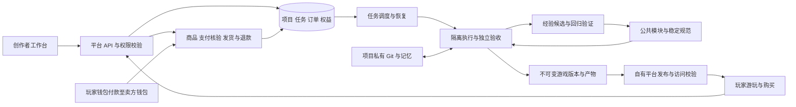

# OpenGame 首版产品与实施规格

更新日期：2026-10-14。目标是让用户描述游戏、在线试玩、对话修改、保存版本并分享，玩家可以购买游戏或永久商品。创作界面沿用已选的试玩优先布局，模型和模块选择由后台处理。

本规格把[架构与实施路线](ai-platform-research.md)中的方向落实为页面行为、数据边界和验收任务。第一阶段已在 `packages/web` 实现本机创作工作台、真实 Codex 生成与修改、独立项目 Git 和记忆、可玩版本、本机发布，以及公共规范快照和任务经验记录。启动方法与当前实现边界见[本地工作台说明](../../packages/web/README.md)。下述规格还包含待实现的公网多用户、完整经验验证发布和支付链路。

## 首版范围与技术默认

| 能力       | 首版交付                                                 | 后续扩展                                                        |
| ---------- | -------------------------------------------------------- | --------------------------------------------------------------- |
| 游戏创作   | 浏览器 2D 游戏，新建、对话修改、实际试玩；玩法由需求决定 | 3D、联机和其他运行环境，分别实现与验收                          |
| AI 执行    | 一个 Codex 执行入口；先用现有订阅完成本人本地验证        | 验证可用于线上服务的接入方式，再扩并发与模型；Gemini 为后续选项 |
| 项目资产   | 每项目独立私有 Git、记忆、不可变版本和构建产物           | 团队协作、代码编辑器、GitHub 导出                               |
| 复用与改进 | 少量公共模块、有版本的公共规范、经验候选与验证发布       | 更多能力模块、规范覆盖范围和维护自动化                          |
| 发布       | 自有平台试玩与分享，创作版本与上线版本分开               | Steam、Roblox、微信小游戏等逐项接入                             |
| 玩家购买   | 一种稳定币、一个网络，游戏访问权与永久商品；先测试网     | 消耗品、更多币种与网络、平台服务费自动分账                      |

实现默认采用 Web/API、常驻 worker 和数据库三个运行单元；公共模块、规范和交易逻辑先作为同一代码库内的库管理。业务数据建议从 Postgres 起步，任务队列复用数据库，避免本地与公网各写一套任务状态。Next.js、Supabase 和 E2B 的托管组合仍是部署候选，选型依据见架构文档。

首轮全局生成并发为 1，同项目同时只允许一个改变版本的任务。具体超时、修复次数和用量上限由首轮实测配置。USDC 与 Base 是支付技术候选，先验证 Base Sepolia；不把这一候选当作用户已经锁定的币种。地区选择按现有约定暂缓，不阻塞设计与测试网开发。个人订阅验证不等于已具备公网多用户的服务接入和容量。

## 页面与完整用户路径

| 页面           | 主要内容与动作                               | 必须呈现的状态                                         |
| -------------- | -------------------------------------------- | ------------------------------------------------------ |
| 创作入口       | 一句话需求、最近作品、创建游戏               | 空作品库、提交中、额度或服务暂不可用                   |
| 创作工作台     | 主要区域试玩，侧边对话；顶部版本、停止、发布 | 排队、制作、验证、保存；失败时继续展示上一可玩版本     |
| 我的作品       | 私有项目、最近可玩版本、上线状态、继续创作   | 首次生成未完成、生成失败、未发布、已有新版未发布       |
| 游戏详情与游玩 | 封面、玩法说明、操作方式、免费试玩或购买入口 | 未购买、支付确认中、已购买、暂停销售、暂不可用         |
| 商品与收入     | 商品权益、定价、收款配置、订单和退款记录     | 未配置收款、测试网模式、待确认、待发货、已到账、退款中 |
| 我的购买       | 已购游戏与商品、订单状态、继续游戏、退款申请 | 换设备恢复、到账待发货、退款审核与到账结果             |
| 内部维护       | 失败任务恢复、付款异常、规范候选与发布结果   | 只向授权维护者开放，记录操作依据与结果                 |

工作台不出现模型下拉框、必选游戏类型或模块拼装表单。进度来自真实任务阶段与事件，未知完成时间显示“正在制作”，不用模拟百分比。技术日志留在可展开的详情中；主要提示告诉用户还能试玩什么、是否需重试、下一步是什么。

**创作者路径：** 描述玩法 → 自动创建私有项目 → 制作与验收 → 试玩 → 输入修改 → 得到新版本 → 选择版本与商品设置 → 发布到自有平台 → 分享链接。用户提出需求超出已支持能力时，说明缺失能力与可交付范围，不悄悄改成现有模板。

**玩家路径：** 打开分享链接 → 免费游玩或查看商品 → 登录平台账号 → 连接已支持的钱包 → 核对商品、网络、金额与网络费 → 钱包确认 → 等待后台核验 → 自动获得权益。免费游玩不强制绑定钱包；购买记录归平台账号，钱包只承担付款与必要的地址验证。

关闭页面不取消生成或支付核验。停止生成后，页面先显示“正在停止”，待执行进程结束再显示“已停止”。付款后的玩家看到“已到账，正在发放”时不能再次购买同一永久权益；发货由后台补偿重试。

## 模块职责与信任边界

| 代码边界                                   | 对外提供                                           | 隐藏在内部的责任                                             |
| ------------------------------------------ | -------------------------------------------------- | ------------------------------------------------------------ |
| `packages/web`                             | 创建项目、提交需求、查看任务、发布、购买与查询权益 | 登录、资源归属校验、参数验证、请求去重；不在请求进程执行生成 |
| `packages/web/src/server/worker-main.ts`   | 领取与恢复任务、取消任务、完成版本                 | 并发控制、执行时限、仓库与产物保存、检查点恢复               |
| `packages/web/src/server` 的执行与构建模块 | 输入需求与基础快照，输出候选改动、事件与验收报告   | 上下文组装、Codex 执行、修复循环、构建与浏览器验收           |
| `packages/web/resources/modules`           | 提供可选能力模块，记录项目内采用情况               | 实现、生命周期、测试；后续补兼容检索与跨玩法验证             |
| `packages/web/resources/standards`         | 提供固定规范快照，数据库记录任务经验               | 证据归纳、冲突处理、回归验证与规则发布仍待实现               |
| 交易模块（后续）                           | 请求购买、查询订单、查询权益、处理退款             | 服务端定价、订单归属、链上核验、幂等发货和账务               |

这些路径是待实施的边界，不要求一次建立所有空包。先打通使用者与实现，再抽出已经有明确职责的模块。首版无单独的通用引擎插件平台、支付网关集群或发布适配器市场。

生成工作区只获得当前任务需要的项目快照、模块和规范，以及受限的执行凭证。数据库管理密钥、其他项目、收款签名权限不进入工作区。代理输出、游戏页面和项目文本都不能自行宣布验收通过、订单付款成功或公共规范生效；这些结果由对应可信服务验证。

游戏运行在与主站分离的 origin。购买界面由可信主站承载，游戏只通过受控通道请求购买商品或查询本游戏权益。通道校验窗口来源、已建立的会话、消息结构、游戏与版本；使用独立 origin 时校验 origin，使用不透明 origin 时绑定经过初始化的 MessageChannel，不把任意 `postMessage` 当作可信购买请求。登录凭证和钱包授权不会发送给游戏。

## 项目记忆与版本一致性

每个游戏使用平台管理的独立私有仓库，不要求用户开通 GitHub。首版采用以下项目文件约定：

| 文件                   | 内容                                               |
| ---------------------- | -------------------------------------------------- |
| `game.project.json`    | 项目标识、运行环境、启动与构建入口、能力清单       |
| `design.md`            | 玩法目标、核心规则、输入方式、胜负条件、验收场景   |
| `memory.md`            | 已确认偏好、历史决策、已验证约束、未解决问题与来源 |
| `modules.lock.json`    | 所用模块准确版本、内容校验值、本地修改与来源       |
| `standards.lock.json`  | 本次使用的稳定规范版本、规则清单与内容校验值       |
| `assets.manifest.json` | 素材标识、存储引用、校验值、来源与使用范围         |

源码与上述文件在同一个 Git 提交中保存。完整聊天、任务事件、订单和玩家权益留在数据库；大素材、产物与仓库备份留在对象存储。构建依赖锁文件、执行镜像版本和验收报告一起记录，以便复现；不能只保存一个 Git 提交号就声称任何时候都能重建。

项目记忆区分“用户已确认”“验收证明”和“尚未验证”。摘要不能把模型猜测写成用户决定；每条重要决定关联相应消息或任务。修改任务恢复所选版本记忆，再加载与本次需求相关的对话；跨项目检索不读取其他私有记忆。首版用结构化摘要和按需检索即可，不依赖向量数据库。

**保存一次可玩版本的顺序：**

1. 接收需求时锁定 `base_version_id`、请求幂等键和项目归属。运行中保留用户新的文字为草稿，不自动叠加执行；再次提交时绑定新的基础版本。
2. worker 领取任务并持有租约和递增执行代次，在独立工作区恢复基础提交，锁定模块与规范，运行生成、构建和可信验收。
3. 验收通过后登记待完成记录，以任务和执行代次为键保存源码提交、仓库备份、产物及校验值。候选提交保留独立引用，暂不改变项目当前版本。
4. 确认源码、产物和报告可读取后，在数据库事务中登记不可变 `game_version`，核对执行代次、未取消状态及基础版本仍匹配，更新当前可玩版本并结束任务。
5. 保存中断由恢复任务检查已有记录继续完成；不因为数据库回写失败就重新调用模型。旧执行进程恢复后不能覆盖新代次的结果。不能完成的候选保留排查记录，按保留策略清理。

Git、对象存储和数据库之间不假设存在一个共同事务。页面只有在第 4 步完成后才显示“已保存”。任务的生成、验证和保存阶段分别记录，保存失败仍提供上一已保存版本。

同项目版本修改与版本恢复使用相同的串行控制。恢复旧版创建一条新的历史记录，注明恢复来源，不删除后续提交或聊天。`latest_playable_version_id` 与发布目标的 `released_version_id` 分别维护；公开链接只解析已生效的发布引用，正在制作的内容不影响现有玩家。

## 任务恢复与接口约定

任务业务状态采用 `queued → running → succeeded / failed / cancelled`，`running` 另含准备、制作、验证、保存等阶段。超时或失联先撤销旧执行代次并终止旧执行环境，再决定恢复保存还是有限重试。模型执行不保证只发生一次；请求和最终版本保存必须去重，用量记录区分每次尝试。

| 操作           | 输入中的关键约束                                 | 结果                                                       |
| -------------- | ------------------------------------------------ | ---------------------------------------------------------- |
| 新建项目并生成 | 用户需求、请求幂等键；首版默认浏览器运行环境     | 返回项目和任务标识，重复提交返回原结果                     |
| 提交修改       | 项目、明确基础版本、修改内容、幂等键             | 返回任务；基础版本过期或项目忙时返回可恢复提示             |
| 取消任务       | 任务归属和当前状态                               | 先记录取消请求，停止执行后完成；与成功保存的竞争由事务决定 |
| 查看进度       | 项目权限、事件游标                               | 返回持久化阶段、结果和脱敏错误，断线可补读                 |
| 发布版本       | 已验收版本、发布目标、期望的当前发布引用、幂等键 | 准备并核验访问入口后切换引用；失败保留旧引用               |
| 创建订单       | 当前可售商品标识、付款钱包验证、幂等键           | 服务端返回价格及权益快照、唯一支付请求                     |
| 提交交易线索   | 自己的订单与交易哈希                             | 仅安排后台查询，不接受客户端付款成功声明                   |
| 查询权益       | 已登录玩家、本游戏的受限会话                     | 返回服务端当前权益，不接受玩家自报商品或价格               |

每个接口都在服务端验证用户对项目、订单或游戏会话的访问范围，不能只靠前端隐藏操作。重试参数与原幂等请求不一致时拒绝复用；任务事件按任务与序号唯一，页面据此去重。

发布仅更新经过验收且完整保存的产物引用。先检查产物在实际访问路径可以启动，再标记发布完成。并发发布核对旧引用，未知结果先读取当前发布记录，不盲目重复操作。已发布文件路径不可覆盖，代码版本回退也不改写订单和库存。

## 公共模块与规范的共同改进

初始知识库以本地已有游戏为起点：提炼玩法经验、可复用模块和制作规范。游戏生成后继续积累，为后续游戏准备上下文，不要求每款游戏从零开始。当前已接入基础经验目录、按需求关键词选取、版本化知识快照，以及成功任务的结构化经验归档；新项目经验作为待复验参考，不直接升级稳定规则。实现细节见[游戏知识库](../../packages/web/resources/knowledge/README.md)。

模块按能力而非游戏类型检索。创建一个“抽卡操控飞船迎敌”的游戏时，可以复用卡牌、移动和波次模块，再编写卡牌如何改变飞船的原创规则；库中没有相应能力时生成项目内实现。首轮只抽取样例实际需要的模块。

每个公共模块交付用途、兼容范围、稳定接口、状态所有权、初始化与销毁、依赖版本和行为验收。公共版本不可原地修改；项目内修改记录来源，升级在新工作区验证后形成游戏新版本，不能覆盖项目自定义代码。

所有开发任务都记录经验：任务及项目来源、加载的规范与模块、问题与原因、修复前后证据、是否实际通过、能否共享。规范维护从这些记录提出改进；贡献前去除私有剧情、个人信息和密钥，代码提取还须符合原内容的许可和贡献范围。

规范改进依次经过候选、复现验证、反例检查、代表性组合回归、稳定发布和采用效果跟踪。首批回归库就包含重新开始、重复进入场景、资源缺失、暂停恢复与常见编辑；新增规则需附能检验自身问题的样例。候选产生次数不等于独立证据数，模型自评不能代替实际结果。

可确定验证、范围明确且通过全部门槛的改进由维护任务自动发布；手感和美术偏好作为带条件的建议，证据不足的候选继续保留。公共发布采用独立权限和串行版本检查，项目执行器没有直接改稳定规范的权限。发现退步时撤回推荐并保留历史，后续任务改用修订版本。

运行中的任务固定规范快照；后续适用任务使用最新兼容稳定版本。因此一个项目发现的问题能帮助其他开发者，已上线游戏仍保持原产物。这里的进化发生在规范、模块和验证样例中，不要求训练或修改模型权重。

## 数字货币购买闭环

### 首轮商品与资金路径

首轮先用一个自营游戏、一项游戏访问权和一项永久商品走通交易；商品必须能在已验收版本中兑现。测试通过后再开放多个开发者的商品与已验证收款地址。每张订单只买一个商品，数量为一，不加入购物车、赠送、可转售道具、平台余额或消耗品。

资金由玩家钱包直接付到卖方钱包，平台读取链上结果并发放平台内权益。收款地址变更需要重新验证，且只影响新订单。平台服务费比例和收费方式仍待确定；收入统计中明确区分卖方到账和服务费记账，不把记账当成已自动抽成。

主网与测试网分别配置网络、代币合约、收款地址和订单环境。可信配置使用官方列出的原生代币地址，不依据代币显示名称识别资产；Circle 列有 Base 和 Base Sepolia 的 USDC 合约地址。[Circle 合约目录](https://developers.circle.com/stablecoins/usdc-contract-addresses)

### 一笔付款准确对应一张订单

首轮技术验证采用“订单绑定唯一付款授权”的候选方案。Circle 的代币代码提供 `transferWithAuthorization`，授权包含付款方、收款方、金额、有效期和 nonce，并记录授权使用事件；是否适用于目标网络的当前部署，仍需实测确认。[Circle 授权转账实现](https://github.com/circlefin/stablecoin-evm/blob/master/contracts/v2/FiatTokenV2.sol)，[授权验证与事件](https://github.com/circlefin/stablecoin-evm/blob/master/contracts/v2/EIP3009.sol)

1. 平台从当前可售商品创建不可变订单快照，生成随机唯一 nonce，关联订单、账号和已验证付款钱包。币种、网络、最小单位整数金额、收款地址与有效期都由服务端固定。
2. 可信结账界面根据这份请求构造授权，签名域锁定网络与代币合约。玩家在钱包中签名并提交授权转账；首轮由玩家承担网络费，先支持实测通过的普通钱包，不宣称所有智能钱包或交易所提现都可用。签名结构依据 [ERC-3009 草案](https://eips.ethereum.org/EIPS/eip-3009)。
3. 后台扫描指定合约的事件，以付款钱包和 nonce 查找支付请求，再核验成功收据、实际调用、对应转账、金额、收款方与有效期。首轮限定直接调用已验证合约的授权转账，不混入未经支持的路由与批量交易。
4. 到账达到确认策略后记账并发货。签名者和订单归属按原支付请求确定，转播交易的人不能凭交易哈希领取商品。同一授权、转账事件和订单都建立唯一约束。

这是一项必须先完成的小型技术验证，不是现成可用的支付实现。验证包括目标合约、签名域、钱包展示、网络费、拒签与重试、事件关联和离线补扫；不通过时更换经过验证的付款协议，不能退回“同一地址收到相同金额就算该订单成功”。不开发新的收款合约，也不由生成代理拼装支付逻辑。

同一账号与商品只保留一张未结订单，已有永久权益不允许重复购买。首次请求固定付款钱包，过期前不另发可重复支付的授权；关闭页面或取消钱包弹窗不会自动撤销已经签出的链上授权。仅当核验覆盖有效期的最终确认链数据并确认未付款后，才能结束旧请求并创建新订单。普通手工转账缺少订单授权时进入异常核对，不自动发货。

### 确认与发货分别记录

| 状态         | 服务端事实                               | 玩家看到的结果                   |
| ------------ | ---------------------------------------- | -------------------------------- |
| 待付款       | 有效支付请求尚无匹配交易                 | 继续付款或等待已有请求结果       |
| 确认中       | 发现匹配的成功交易，尚未达到确认策略     | 显示确认进度，阻止重复购买       |
| 已到账待发货 | 付款已核验并落账，发货任务已持久保存     | 无需再次付款，后台继续发放       |
| 已完成       | 权益及发货凭证成功保存                   | 进入游戏或使用商品               |
| 已过期未付款 | 有效期已过且核验覆盖对应的最终确认链数据 | 可以重新创建订单                 |
| 异常待核对   | 错币、错链、金额不符或无法建立订单关系   | 说明原因与订单编号，不伪装成成功 |

技术验证初始采用较保守的策略：交易所在规范链区块达到 `finalized` 后才发放永久权益，记录区块高度和哈希；实测等待时间再决定是否需要对小额交易制定更快的策略。Base 区分 unsafe、safe 和 finalized 区块；钱包提交成功不等于最终确认，不预先承诺几秒到账。[Base 区块确认层次](https://docs.base.org/base-chain/specs/protocol/consensus/derivation)

扫描器保存断点，重启补扫并复核未最终确认的交易。重组导致交易不再位于规范链时撤销待确认记录、继续查询；已按最终确认发货后发现异常则进入事故对账，不自动二次扣款。RPC 不可用显示延迟，不当作付款失败。授权有效性依据链上执行时间，付款在有效期内执行但晚被扫描到，仍继续确认与发货。

确认收款、订单更新和发货任务写入同一数据库事务；发货时将权益与唯一发货凭证写入另一事务。重复扫描、重复消息和重启只重做未完成步骤。单纯调用钱包成功、前端传入哈希或监听器通知都不能直接解锁商品。

### 权益 退款与收入

付费完整游戏的产物保存在受保护路径，入口与资源请求经过权益检查，并采用用户相关的短期授权和正确的缓存策略；猜到资源 URL 不能绕过校验。免费试玩使用独立的试玩产物，不能在公开目录放完整游戏再遮住按钮。浏览器交付的代码仍可能被合法访问者复制，首版实现访问控制，不宣称绝对防复制。

商品标识与权益标识跨游戏版本保持稳定，发布验证检查旧购买是否仍能兑现。暂停销售停止创建新订单；已签出的有效订单仍须核验、发货或按规则退款，不能通过下架抹除收款义务。已购访问与销售开关分别管理，更新范围按购买时商品规则处理。

首版退款只做整单退款。玩家从订单申请，卖方按已公示规则处理，并从收款钱包另行签署退款交易；默认退至原已验证付款钱包。退款复用已验证的授权转账协议，为退款请求绑定新的唯一 nonce。后台核验授权归属、代币、网络、金额、付款方、收款方和未被重复使用的退款事件，按相同确认策略记录退款完成及对应授予的撤回。签名或发送结果不明时先查链，不生成另一笔退款；退款与未完成发货串行处理，发货事务重查退款状态，防止退款后补发。

平台不自动持有卖方退款资金，退款请求不等于退款完成。网络费承担、退款期限和商品更新范围必须在售前规则中明确。收益记录按币种展示销售、已到账、退款、网络费承担情况和服务费，不自行换算成未经核实的法币收益。

后续外部平台的商品与付款走各自适用的官方能力，自有平台的数字币购买接口不会自动植入 Steam、Roblox 或微信小游戏；具体依据和适配路线见[多平台与支付方案](ai-platform-research.md)。

## 数据与不可破坏的约束

| 数据组     | 核心记录                                                           | 不可破坏的约束                                                                            |
| ---------- | ------------------------------------------------------------------ | ----------------------------------------------------------------------------------------- |
| 项目与版本 | projects、game_versions、artifacts、releases                       | 私有记录有归属；版本与产物不可变；创作与上线引用分开                                      |
| 执行与对话 | generation_jobs、job_attempts、job_events、messages、usage_events  | 同项目单活跃修改；请求去重；执行代次阻止失联进程覆盖；用量按尝试记                        |
| 制作资产   | module_releases、standard_releases、experience_records、candidates | 公共发布不可变；任务锁定版本；共享证据有使用范围                                          |
| 商品与钱包 | products、seller_wallets、wallet_verifications                     | 商品由卖方管理；售价服务端决定；收款地址变更不改变历史订单                                |
| 付款与扫描 | orders、payment_intents、chain_events、scan_cursors                | 订单保留价格与规则快照；授权按链、合约、付款人及 nonce 唯一；事件按链、交易及日志位置去重 |
| 权益与退款 | fulfillment_jobs、grants、entitlements、refunds、ledger_entries    | 每订单商品只发一次；永久权益按玩家与权益标识聚合；退款仅撤回对应授予；退款事件不可重用    |

表名用于表达责任，可以在实现时合并。链事件另存区块哈希与规范链状态，以处理重组；不把日志去重键当成最终确认依据。交易金额用最小单位整数，账目更正通过追加记录表达。游戏恢复、重新生成或删除草稿均不能删除付款历史与玩家权益。

备份包含数据库、私有仓库及素材和产物；正式内测前做一次从备份恢复并打开游戏、继续修改、查回订单与权益的演练。公开与私有访问权限都要在恢复后再次验证。

## 开发顺序与验收

| 顺序 | 交付任务                 | 完成标准                                                                                           |
| ---- | ------------------------ | -------------------------------------------------------------------------------------------------- |
| 1    | 单一执行器与最小游戏工程 | 从自然语言创建可玩游戏，再修改一次；真实启动、交互和重新开始通过，记录耗时与用量                   |
| 2    | 任务与项目版本           | 独立 Git 和记忆恢复；生成或保存时重启 worker、重复提交、取消竞争均不会破坏上一可玩版本             |
| 3    | 公共规范与模块最小循环   | 一个真实问题形成规则并通过正反例验证，被另一项目采用；同一波次模块用于两个不同玩法，缺项可自写实现 |
| 4    | 工作台与自有平台发布     | 新建、试玩、对话修改、旧版恢复、发布与分享连续走通；旧公开游戏不受制作失败影响                     |
| 5    | 账号 隔离与内测运维      | 用户间数据隔离、生成沙箱、游戏 origin、执行限额、取消恢复、备份恢复、目标设备输入通过验证          |
| 6    | 数字币付款技术验证       | 在测试网验证钱包与目标代币授权、订单归属、确认策略和断点补扫；不以付款按钮外观代替验收             |
| 7    | 商品 发货与退款          | 一个游戏和一个永久商品完成购买、离线确认、补发、换设备使用、整单退款和卖方对账                     |
| 8    | 内测后的扩展             | 根据实际成功率与用户需求增加模块、运行环境、多开发者交易与外部平台；不提前承诺任意目标一键上线     |

第 1 项开始就记录所用基础规范与经验，第 3 项完成跨项目发布闭环。第 6 项不依赖完整界面，可在执行器验证后用独立的小型测试程序提前排除支付路线问题；正式购买入口依赖第 5 项权限与隔离验收。主网真实收款前再落实运营规则和服务条件，地区相关配置在该阶段补齐。

首批验收固定四组场景：原创组合玩法；波次模块跨生存射击与塔防复用；修改速度、替换角色、增加敌人和换背景；暂停、重开、离开重进与资源加载失败。浏览器验收保存操作轨迹、结果和错误，关键玩法由实际试玩确认。移动端只对声明支持触屏的游戏承诺可玩，不能仅用缩小浏览器宽度代替输入验证。

付款验收另外覆盖同金额不同订单、旧交易冒领、跨账号交易提交、授权重复使用、钱包拒签、未广播、链上失败、过期、扫描延迟、链重组、付款后离线、发货失败、退款与补发竞争。只有正确订单获得一次权益，退款到账才显示完成。

记录首次可玩率、常见修改回归率、生成与保存耗时、恢复成功率、重复发货数、付款确认与发货延迟，以及规范采用后的缺陷复发与误报。前期提供真实样例、分母和失败原因，积累结果后再设服务目标与工期估算。
