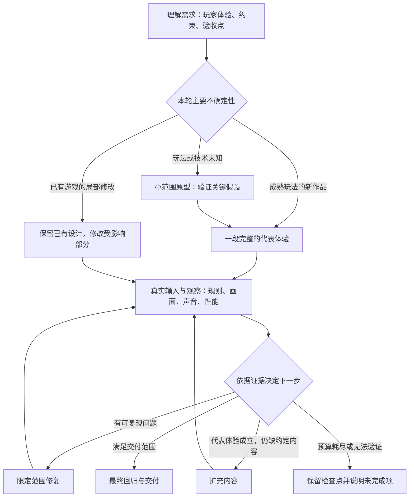

# 游戏制作管线：从可玩体验到证据驱动的迭代

日期：2026-10-23。本文先记录设计基线；用户随后要求继续，最小闭环已接入本地 0.4 候选，验证记录见文末，尚未部署。本文回应“学习制作游戏的更优管线”，并修正上一轮把重点放在视觉要求、合成音效和末尾截图复查的取向。

**目标是提高不同类型游戏的交付质量和稳定性，同时控制制作成本。** 首屏装饰、音效数量、模型调用次数和文档数量都不是这个目标的替代指标。0.3 本地候选提供了部分基础能力；后续 0.4 接入了最小制作闭环，但基础测试通过仍不代表跨类型生成质量已经改善或优于 OhMyGame。

## 1. 从证据出发

| 已核实的事实                                                                                         | 对管线的启示                                                           | 不能推出的结论                                       |
| ---------------------------------------------------------------------------------------------------- | ---------------------------------------------------------------------- | ---------------------------------------------------- |
| OhMyGame 有持续维护的设计上下文、素材用途记录，以及制作中可调用的真实预览操作和图片返回              | 让制作决策延续，让观察发生在制作过程中，素材按游戏用途交付             | 不能证明用户那次作品执行了全部技能，或每次生成都达标 |
| OhMyGame 的正常完成路径没有宿主强制的玩法、美术评分门禁                                              | 学习工具和制作方法，同时补足自己的完成标准                             | 不能直接采用“agent 结束即质量通过”                   |
| 本地 0.3 塔防样例用了 868 秒、3 次模型调用；首轮已写出三种塔和六波内容，随后才修复截图超时、宽窄布局 | 应尽早暴露影响整款游戏的渲染、布局和交互问题，减少在错误基础上扩展内容 | 单个样例不能证明分阶段一定更快                       |
| 0.3 自动试玩由项目提供，最多 12 步、累计等待/按住至多 5 秒；后续人工操作完成首波，未验证六波通关     | 短冒烟检查有价值，但必须明确覆盖范围；胜负、经济和长局需要其他证据     | “试玩通过”不能等同完整玩法验收                       |
| 本仓库已有三个游戏的 27 组独立规则检查；方块布局修复时规则与配置保持逐字节不变                       | 已验证的规则和有范围的修改可以成为回归基础，应先复用现有能力           | 固定样例通过不能证明新提示词改善了生成质量           |

依据：[OhMyGame 源码研究](game-production-pipeline-source-notes-2026-10-23.md)、[本地生成记录](../../output/game-quality-A7jwzo/result.json)、[补充试玩](../../output/game-quality-A7jwzo/sample-playtest.json)、[现有规则回归](../../packages/web/benchmarks/popular/README.md)。OhMyGame 固定在提交 `ca2df725cc4e836e1120ea1f3374e7b99021a903`，不是对截图时后台版本的追溯。

Unity 官方原型教程区分需求验收、探索性测试和用户体验反馈，并强调以核心交互及预期结果组织测试；满足技术要求不代表体验成立。[Unity：Test your prototype](https://learn.unity.com/course/creative-core-prototyping/tutorial/test-your-prototype-3?version=6.0)

《Sky Noon》开发者记录了从多个原型中选择方向，再做内容较少但体验完整的片段，之后才扩充地图与武器；试玩还促使他们修改核心机制。这是一个支持尽早验证体验的案例，不是所有小游戏必须照搬的生产规模。[开发团队的一手复盘](https://www.unrealengine.com/developer-interviews/sky-noon---reimagining-the-wild-west-into-a-first-person-action-brawler)

以下流程是结合这些证据为 OpenGame 提出的设计，尚待对照实验验证。

## 2. 制作顺序由待解决的问题决定

这些是制作决策，不要求固定数量的代理或模型调用。熟悉玩法可以合并原型与代表体验；一处按钮修改不必重走新游戏流程。玩家感受依赖声音、动画或视觉的玩法，应在最早可玩的阶段就验证这些要素，不能统一拖到最后“装修”。

| 阶段                   | 要回答的问题                                             | 最小产出                                                   | 进入下一步的依据                                      |
| ---------------------- | -------------------------------------------------------- | ---------------------------------------------------------- | ----------------------------------------------------- |
| 需求与体验定义         | 玩家反复做什么选择？为什么愿意再玩？用户真正指定了什么？ | 核心循环、目标设备、风格方向、约束、当前风险、可观察验收点 | 用户要求与平台默认假设分清；范围能在预算内完成        |
| 关键假设验证，按需执行 | 最可能导致返工的玩法、技术或素材方案是否成立？           | 只覆盖这个问题的可运行实验或素材接入样例                   | 实际操作/运行结果支持继续；失败时调整设计而非扩大工程 |
| 一段完整体验           | 玩法、造型、界面、动效、声音放在一起是否协调？           | 一局、一波或一个场景，包含适用的结束、恢复与重开           | 核心操作及结果可验证，主要对象可辨，关键反馈可感知    |
| 内容扩充               | 已成立的体验能否扩展而不破坏规则和性能？                 | 关卡、敌人、道具或难度变化                                 | 新内容可达、没有破坏原有回归；用户约定的范围齐全      |
| 定向修复与交付         | 当前证据证明了什么，还缺什么？                           | 复现记录、修复、同场景复测、最终报告                       | 必须项通过；未验证项明确记录，不能用模型总结代替证据  |

用户仍然可以只提一句需求。普通制作判断由平台完成，只有互相冲突、会改变目标的要求才需要澄清，不能把每个内部阶段变成用户审批。

## 3. 设计信息要能约束制作和验收

沿用现有设计文档、任务计划和素材清单，不为每个角色另建一套重复文档。需要补齐以下信息，并让每次修改读取当前版本：

| 信息           | 示例或用途                                                                                 |
| -------------- | ------------------------------------------------------------------------------------------ |
| 核心循环       | 观察敌人 → 选择位置和塔种 → 花费资源建造 → 交战 → 奖励/损失 → 调整下一次选择               |
| 体验目标       | 目标清楚、建造容易上手、选择有代价、攻击命中和基地受伤有可区分反馈                         |
| 需求来源       | “2D、塔防、积木风格”来自用户；塔种数量、波次数、地图尺寸属于当前设计选择                   |
| 代表片段       | 第一波能体现建造与资源取舍；若差异化依赖两种塔，片段就需包含两种，不能为了小而丢掉关键体验 |
| 验收点         | 建造实际扣款；余额不足不建造；敌人漏过扣生命；暂停冻结推进；重开恢复初始规则状态           |
| 视觉与声音规则 | 形状、材质、配色和信息层级服务玩法；关键事件共用明确语义，驱动画面、动效和声音             |
| 素材用途与规格 | 用在哪里、实际显示尺寸、透明边缘/碰撞区域、动画状态、音频触发条件、文件来源和最终加载位置  |
| 待验证假设     | 首波节奏是否过慢、两类塔是否有实际取舍、密集战斗能否分辨关键信息                           |

素材方案在代表片段前决定：能程序绘制就复用和缓存；需要独特造型时评估图片/精灵或用户已有素材；声音可采用合成、现有文件或可用生成服务。以用途和实际可用能力选择，不把一种资源路线固定成所有游戏的审美上限。当前平台尚未具备完整外部音频素材交付链路，规划必须如实反映能力。

素材生成成功只表示文件存在。只有导入、缩放/裁切、透明边缘、动画或播放、层级与性能均在真实场景里检查过，才能算该素材已交付。概念图也不能替代可交互画面。

## 4. 试玩证据要比“自评通过”更可靠

验收目标应在实现前由需求确定，由平台保留版本；制作过程可以提出修改，但不能悄悄删除失败项。实现可以提供输入映射和测试适配，判定标准不能完全由同一份实现自由选择。给模型换一个“评审员”角色并不会自动产生独立证据。

| 证据层                         | 适合证明什么                                          | 主要限制                                           |
| ------------------------------ | ----------------------------------------------------- | -------------------------------------------------- |
| 可信规则检查                   | 资源守恒、合法状态转移、胜负、重开、随机性与边界      | 通过纯规则不代表实际界面接线正确                   |
| 真实输入和可观察结果           | 玩家操作确实到达规则，按钮/画布可用，状态改变符合预期 | 一条快乐路径不代表失败和边界路径                   |
| 代表状态截图、必要的短时序记录 | 构图、层级、遮挡、提示、动效和战斗可读性              | 静态截图不能证明时序、手感和音质                   |
| 音频事件、信号及人工听感       | 实际事件有输出、静音/暂停/重开不残留，听感是否协调    | 非零 PCM 或事件计数不能证明悦耳或符合主题          |
| 目标用户试玩                   | 是否理解操作、是否存在有意义选择、挑战和挫折是否合理  | 少量反馈不能证明商业留存；自动代理不能替代真实玩家 |

现有 `playtest.json` 继续作为受限的短冒烟检查。完整验收应由多个有时间上限的场景组成，而不是取消执行限制。难以短时间到达的胜负状态可使用隔离测试场景与固定种子，但必须走真实推进、碰撞和结算逻辑；记录“场景测试通过”，不能冒充自然玩完全程。项目自己设置 `passed=true` 不构成证据。

每条问题记录最少包括：对应验收点、代码/构建版本、输入和初始条件、实际结果、期望结果、证据位置、严重程度、受影响范围。修复后用相同条件复测，再执行受影响的回归。原证据不能覆盖为修复后的画面。

平台必须区分 `passed`、`failed`、`not_run` 和 `unsupported`。模型视觉评审只是一种带理由的判断；“已评审”、截图齐全、无布局警告，都不能自动换成“美术达标”。

## 5. 用这款塔防说明具体变化

本例不预设要复刻右图的配色、布局、树木和城堡。积木风格可以有不同的世界观与构图。应该验证的是：视觉是否让玩家看懂可建造处、炮塔功能、敌我关系和当前风险；建造、命中、奖励、受伤的反馈是否一致。

第一阶段做一张地图、覆盖核心选择的少量塔与一波敌人：选位置 → 建造扣款 → 开波交战 → 命中/奖励 → 漏怪损失或守住 → 结算/重开。此时便用实际宽窄视口观察，并检查关键声音；胜负可另设受控场景验证。片段中的素材和渲染方式要能承受计划中的密度。

如果敌人没来之前空等太久，下一轮调整节奏；如果玩家辨认不出两种塔，下一轮调整造型和信息；如果密集开火盖过基地受伤音，下一轮调整声音优先级；如果布局被裁切，下一轮改布局并复验建造输入。每项修改都由已观察的问题触发。代表体验通过后，才扩充用户约定的完整内容。

“三种塔、六波”是上次生成的设计选择，不是原始提示词中的硬要求。该例没有证明这些数量更好，也不能把它们固化为全平台模板。

## 6. 对现有 0.3 候选的处置与落地顺序

| 现有部分                                    | 处置                                           | 原因                                               |
| ------------------------------------------- | ---------------------------------------------- | -------------------------------------------------- |
| 项目隔离、独立构建、取消与失败保留旧版      | 保留                                           | 是制作与验证的基础                                 |
| GameAudio、真实输入执行、尺寸截图、证据导出 | 保留为工具能力                                 | 能被多个制作阶段复用，但不能单独代表成品质量       |
| 每款游戏默认固定追加一次截图润色            | 下一步改为按证据和范围选择复查/修复            | 无缺陷时不应强制再改；有缺陷时一轮又可能不够       |
| 泛化的美术/声音要求                         | 改为面向这款游戏的对象、动作和反馈计划         | 支持不同美术路线，减少清单式堆叠和塔防过拟合       |
| `reviewed=true`                             | 明确其仅代表执行过复查，后续由逐项证据表达结果 | 当前赋值并不保证最终视觉问题解决                   |
| 现有 27 组规则回归                          | 作为种子继续使用和扩展                         | 已有可信规则、失败样例和检查器，比重新搭空框架有用 |

落地应先完成一个能跑通的闭环：**带验收点的体验计划 → 可保存的代表片段 → 受控试玩返回图片和结果 → 只处理已发现问题 → 同条件复测。** 验证这条闭环后再扩展素材服务、更多玩法适配和长局测试，不先堆代理角色。

具体接入位置：规划层扩展 `developmentPlanSchema` 与 `planInstructions`；制作编排替换 `generateReviewedGame` 的固定末尾润色；现有 `build-game.ts` / `game-playtest.ts` 提供受控观察；验证结果承载验收点与证据映射。业务判断集中于制作编排，浏览器和音频模块只提供操作与观测能力，不各自决定“游戏已经做完”。这些是设计阶段提出的职责，后续实施的具体范围见文末。

观察能力应在制作阶段可调用，接入方式可以是宿主阶段调用，也可以是受控工具；两者都必须沿用隔离环境和允许的输入。无需向生成器开放宿主权限或任意浏览器脚本。先做最小可用路径，再以首个可玩耗时、修复效果和成本决定是否进一步集成。

每次任务共享总预算，记录剩余时间、调用次数和用量，并为最终验证保留空间。基础设施不可用不应让模型反复修游戏。相同问题重复出现时先重新诊断；预算不足则保留最后检查点并准确报告完成范围，不能把未满足的必须项自动降级为通过。修改已有游戏时，已发布版本继续由现有失败保护机制保留。

## 7. 怎样判断管线真的更好

先做小规模配对试验：塔防、益智、动作三类原始需求，各重复两次，现有 0.3 候选与新闭环各六次。它只能发现明显退化和验证成本估计，不能作为统计显著性的宣传。成熟后再扩大样本。另保留无声/极简需求、旧游戏局部修改和故障恢复的回归用例。

记录确切模型、推理设置、平台与规范版本、资源能力、提示词、预算、种子、各阶段耗时和用量。两组使用相同资源条件与总预算上限；实际消耗可以不同。若要研究素材工具的贡献，应另做单变量实验，避免把换模型、换工具与改流程混在一起。

| 指标             | 比较方式                                                             |
| ---------------- | -------------------------------------------------------------------- |
| 基本正确性与覆盖 | 独立验收点通过率，失败/未运行均保留；包括失败结算和重开              |
| 可玩体验         | 盲评是否容易理解、选择是否有意义、反馈是否清楚；真实玩家试玩单独记录 |
| 视听一致性       | 同视口、同阶段、同动作对照；听音频或看时序，不能只评首屏             |
| 效率             | 第一次可玩的时间、总耗时、调用/用量、返工次数；失败与超时也计入      |
| 修改稳定性       | 局部修改是否破坏既有规则、输入、素材及性能                           |

先预登记必须项和比较方法，再看结果；不挑选最好的一张图代表整个流程。只有新的生成对照才能检验管线效果，单元测试和固定规则回归只证明基础能力没有明显回退。

## 研究阶段交付边界

研究阶段完成源码机制复核、0.3 候选的缺口分析和本方案，当时未改运行代码或发起生成、部署。0.3 的 23 文件补丁及原始测试证据作为历史快照保留，不能代表后续 0.4 的当前文件。

## 用户要求继续后的 0.4 本地实现

以下是最小可执行闭环，不是上文所有长期能力已经完成。新增外部素材服务、独立纯规则推导器、视频/听感评测和跨类型盲测尚未实现。

| 部分         | 本轮实际接入                                                                                                                                            |
| ------------ | ------------------------------------------------------------------------------------------------------------------------------------------------------- |
| 制作约定     | 对话规划可保存 production：核心循环、首个可玩范围、完整范围、风格、反馈、假设和2–6个验收点；旧计划或直接生成先在只读环境补齐                            |
| 阶段推进     | 新建先做 slice；只有本阶段验收通过才进入 delivery；简单作品可一次完成，已有游戏直接验证本轮修改                                                         |
| 独立评审     | 评审会话对源码只读，查看实际画面与验证结果，逐项提出依据、问题和待执行场景；不直接修改游戏                                                              |
| 受控验收     | 场景由宿主保存到项目之外的只读输入，按真实点击/按键及可见文本执行；期望与输入冻结后不得弱化；失败会阻止交付                                             |
| 分支与长流程 | 最多八个场景，同一目标可以分别验证成功/失败；按需使用命名初始局面接口，必须继续走正常玩法，结果明确记录 scenario，不冒充自然通关                        |
| 迭代与停止   | 没有问题就停止；已发现问题定向修复，再跑原场景。最多四次制作、四次评审，共用任务预算并预留120秒检查时间，失败/取消不替换旧版本                          |
| 证据和恢复   | 每个成功构建保留源码、静态游戏、实际截图、检查用例与结果；即使行为检查失败，证据也保留。最终版本保存 production-report.json，逐项区分真实操作与表现评审 |
| 版本边界     | 中间检查点位于受保护的 .opengame-context，提交时强制排除，不依赖生成器是否保留 .gitignore                                                               |

代码入口：[制作约定](../../packages/web/src/shared/game-production.ts)、[制作编排](../../packages/web/src/server/game-generation.ts)、[受限输入与断言](../../packages/web/src/server/game-playtest.ts)、[实际浏览器检查](../../packages/web/src/server/build-game.ts)、[容器与受控输入](../../packages/web/src/server/project-runtime.ts)、[规范0.4](../../packages/web/resources/standards/0.4.0.md)。运行镜像改为 `opengame-project-runtime:0.4.0`；无需新增数据库表。

### 本地检查与真实生成记录

- 最新基础回归共53项通过，包含补充证据后只读复评、不额外改代码、pending-test只有实际执行通过才放行，以及只有不可验证缺口时停止改写的回归。[完整测试日志](../../output/game-production-pipeline-20261023/unit-tests-final.log)。较早的整组运行中，2项浏览器/回环服务测试因本机沙箱禁止启动而失败，允许本地测试进程后复跑通过；不是靠修改测试预期消除失败。
- 独立容器测试6项通过，Linux专用生成器隔离检查2项在macOS按规则跳过；受控初始场景加入后，2项相关容器测试再次通过，覆盖实际输入、精确结果、状态重置、项目无法替换宿主用例、未知场景失败和场景证据。
- 对话与版本保存集成测试8项通过，使用创建后销毁的独立本地数据库，覆盖计划冻结、版本恢复、取消、项目归属和额度。将新production约定加入用例后再次全部通过，确认其经规划解析、保存版本和恢复后仍完整保留；类型检查通过。
- 第一轮真实生成在规划时发现长流程目标与原短试玩能力不匹配，主动停止。共356.5秒、2次模型调用、尚未进入浏览器检查；记录为中止，不能计作生成成功。[中止记录](../../output/game-quality-SWw25o/failure.json)
- 第二轮采用原始塔防提示词，请求 `gpt-6-astra`，共1,025.3秒、6次模型调用、5次检查，最终失败，未进入完整内容交付。前三次技术检查遇到截图/输入超时；第四次制作后小样与三个独立场景通过，但评审此前的“缺少执行证据”仍被编排当成改代码理由，耗尽四次制作机会。[完整失败记录](../../output/game-quality-dBLmYn/failure.json)、[已通过的三个场景](../../output/game-quality-dBLmYn/check-5/validation.json)。失败样本保留，不计为成功。
- 针对第二轮做单变量对照：复制同一份源码，只改变 Phaser 渲染模式。Canvas在6.7秒完成12步操作及多尺寸检查；AUTO在10.9秒时以点击超时失败。两次使用相同运行镜像，源码哈希与结果均保存。这只说明该小样在当前环境的差异，不能泛化为所有WebGL作品都更慢。[对照记录](../../output/game-production-pipeline-20261023/renderer-check-YTcY3g/result.json)
- 随后修正：普通2D优先采用已验证的Canvas默认方式，正常游戏与测试共用；保留操作错误末尾的遮挡/重试原因；新增场景通过后，只有证据缺口的评审返回只读确认，不消耗一次写入制作。
- 第三轮继续使用原始提示词，运行目录为[game-quality-ujPN8b](../../output/game-quality-ujPN8b/)。小样首次技术检查通过，两个独立场景通过，并经只读确认后进入扩充；扩充阶段用尽预留最终检查之外的模型时间，在约18分钟停止，未验收扩充版，仍记失败。另发现奖励用例误把小样的“1 / 2”总波数冻结，与计划扩充六波冲突；尚未执行完整版本中的这个断言，不能宣称其已导致运行失败。
- 针对第三轮增加 `pending-test`：仅用于本次已提出明确用例、其他评审依据成立的行为项，只有平台真实执行通过才确认；失败不放行。保留 `unverified` 供其他证据缺口使用。评审明确检查回归预期与完整范围兼容，扩充阶段收到完整冻结场景；禁止伪造小样显示迎合错误检查。用例语义仍可能误判，当前没有形式化证明器。
- 在新目录[game-quality-0uizj8](../../output/game-quality-0uizj8/)进行十分钟上限的诊断续跑，复制第三轮未完成源码，保持原制作约定，重新审查并执行全部验收点。此为续跑，不是新鲜样本；旧“1 / 2”断言的修正须明确记录，不能声称原用例通过。推理档位均未显式设置，不能宣称与历史样本完全相同。各轮直连实际制作流程，不覆盖账号、数据库保存或线上发布。
- 上述续跑的六个独立场景全部通过：资源不足、击败奖励、升级与回收、胜利后重开、失败后重开、手动暂停。最后缺少真实失焦证据，约407.5秒时主动停止，记为中止，不是成功交付。原“1 / 2”断言已在这次重新审查中被稳定的战斗/奖励检查替代；原始错误用例与失败样本未改。[六场景结果](../../output/game-quality-0uizj8/check-2/validation.json)
- 据此修复编排：只有无法验证的缺口、没有已知实现缺陷时停止，不再消耗制作调用。新增固定页面切换操作以补齐此次缺失能力；每场景最多离开/返回一次，仍受12步限制，不允许任意脚本或伪造blur事件。
- 真实焦点探测发现Playwright默认模拟所有页面始终有焦点；关闭模拟后，精简headless-shell仍不触发失焦，而完整Chromium会触发。导航会重置相关状态，因此在导航后、开始按钮之前关闭模拟。容器已改为完整Chromium的无界面模式，未采用虚拟显示器，也未修改游戏规则。[探测记录](../../output/game-production-pipeline-20261023/focus-probe.json)、[真实失焦/恢复的容器测试](../../output/game-production-pipeline-20261023/focus-runtime-final.log)。仅覆盖真实浏览器标签切换，不能推广为所有操作系统切窗或手机后台行为均验证。
- 更新浏览器后再次以完全相同的小样做渲染对照：Canvas在7.6秒通过，AUTO在11.7秒以输入超时失败，二者源码哈希与先前对照保持一致；该具体样例的结论在最终环境中复现，仍不泛化到所有项目。[最终环境对照](../../output/game-production-pipeline-20261023/renderer-check-8gmMlB/result.json)
- 最终诊断续跑[game-quality-THkRQU](../../output/game-quality-THkRQU/result.json)通过：265.5秒（4分25秒）、2次模型调用（一次制作、一次只读评审）、2次容器检查。七个独立场景均通过，覆盖资源不足、击败奖励、升级回收、胜利后重开、失败后重开、手动暂停及真实切页失焦/继续。原制作约定未变，平台文件哈希与运行时记录一致；报告保留五个行为验收点和一个模型表现判断。此为从已有源码续跑，不能声称从零生成只需4分25秒。
- 真实失焦场景在正常漏怪局面点击开波，切离1000毫秒，返回后核对暂停提示，再等待1000毫秒确认耐久仍为1，点击继续后出现正常漏怪失败；没有向游戏注入假事件或直接设置结算。[最终冻结场景](../../output/game-quality-THkRQU/check-2/acceptance.json)、[最终执行结果](../../output/game-quality-THkRQU/check-2/validation.json)。胜负场景仅改变初始局面，仍不等于自然从头通关；声音仅检查调用与控件，听感未验证。
- 最终源码的正式构建通过。构建最初遇到输出目录的依赖解析问题，改用包内隔离输出目录后解决；Next自身升级提醒使首次构建停止，按其普通重试路径再构建成功，未关闭检查。当前Next版本仍报告安全升级提醒，部署前需单独处理该依赖问题。[最终成功构建日志](../../output/game-production-pipeline-20261023/production-build-final-retry.log)。构建自动修改的类型路径配置已恢复为本轮之前的原内容。

第一轮停下后增加受控初始场景，是修正验收能力，而不是更改游戏规则迎合五秒时限。模型评审仍可能误判，测试适配也由模型提出；宿主能保证既定场景实际执行及失败不放行，不能自动证明所有需求已被完整表达或覆盖。

本地源码改动以 `output/game-production-pipeline-20261023/baseline-manifest.json` 记录的上一轮工作区为基线，保留既有未提交修改。未改线上服务、已发布游戏或其他用户项目。

本轮20个文件的独立[代码补丁](../../output/game-production-pipeline-20261023/pipeline-0.4.patch)及[文件哈希清单](../../output/game-production-pipeline-20261023/change-manifest.json)已生成，并在隔离的基线副本中验证可以应用、结果逐字节一致；它以改动前工作区为基线，不以Git HEAD为基线。研究说明作为旁附文档，未混入其他既有改动。[验证汇总](../../output/game-production-pipeline-20261023/verification.json)

### 当前结论

最小制作闭环已接入，并通过真实续跑验证。修复依据来自实际失败：渲染成本、重复证据确认、会随内容扩充失效的断言、缺少失焦观测，以及把证据不足误当成实现缺陷。没有复制对照游戏的布局或素材。

三次从零运行均未完成全部交付，后续两次续跑最终补齐验证。它们是开发诊断过程，版本条件也发生了变化，不能作为新旧管线的成功率比较。当前仍需用最终固定版本进行新鲜样本的配对试验，尤其检验总预算、内容范围、跨类型稳定性和真实视听体验。只读评审及用例设计仍可能有语义遗漏；独立执行能阻止已发现的失败通过，但不是完整游戏质量的证明。
