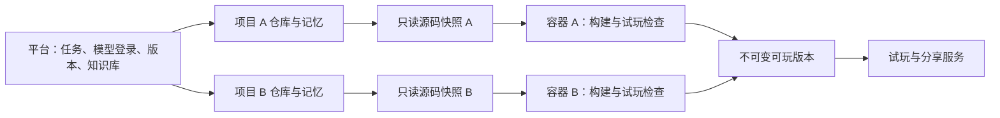

# OpenGame 创作工作台

创作流程：描述游戏 → 保存体验与验收约定 → 制作可玩片段 → 独立运行与只读评审 → 按证据修复或扩充 → 最终复验 → 试玩与保存版本 → 发布分享。简单作品可以一次完成，已有游戏修改直接验证本轮变化。工作台采用试玩优先布局，不要求用户选择游戏类型。

支持本机个人创作，以及少量受邀成员创作 Phaser 2D 浏览器游戏与 Three.js 3D 观赏场景。源码按项目独立保存，生成不是替换预设游戏模板。受邀模式已加入个人访问码、项目归属、制作额度和受保护的分享链接；公网接入还需要配置实际后台主机和两个 HTTPS 地址，见[内测部署说明](deploy/README.md)。已增加可选的 Privy 邮箱验证码 / Google 注册；3D 首期支持程序化场景、材质灯光、粒子和镜头，沿用作品预览、版本保存及分享；外部模型生成、联机、跨平台发布和数字货币购买属于后续阶段。

## 邮箱与 Google 登录

通过 Privy 提供邮箱验证码和 Google 注册/登录，登录时不创建钱包。启用方式、控制台配置和旧账号绑定见 [Privy 接入说明](deploy/privy.md)。默认配置继续使用原来的本机或访问码模式；配置 `OPENGAME_AUTH_PROVIDER=privy`、`OPENGAME_ACCESS_MODE=invite` 与公开 App ID 后开放注册。App ID 从服务端会话接口提供，构建不需要嵌入环境变量，也不需要 App Secret。

## 启动

在仓库根目录执行：

```sh
npm install --workspace=@opengame/web --ignore-scripts
npm run runtime:prepare --workspace=@opengame/web
npm run studio
```

打开 <http://127.0.0.1:4190>。启动程序会准备本项目自己的数据库、参考作品、制作进程和游戏预览服务。已有项目会继续保留。“星尘远航”明确标为参考作品；从输入框创建的游戏使用真实 Codex 任务。

需要 Node.js 20.9+、Git、已登录的 Codex CLI、PostgreSQL 的 `initdb`/`pg_ctl`、运行中的 Docker，以及 Chrome 或 Playwright 的 Chromium（首次准备内置参考作品使用）。先启动 Docker，再执行一次 `runtime:prepare`，下载官方 Playwright 镜像并构建固定工具链；修改构建工具或检查代码后需重新执行。生成游戏的构建与自动试玩在容器内执行。使用现有数据库时设置 `OPENGAME_DATABASE_URL`，并自行管理数据库的启动。

Codex 使用运行服务的系统账号已有的 CLI 登录；可先用 `codex login status` 检查。平台没有新增 API Key 设置或模型选择入口。非交互执行和 JSON 事件依据 [Codex 官方文档](https://learn.chatgpt.com/docs/non-interactive-mode)。目标主机须使用支持命名权限配置的 CLI，并通过 `generator:check`；当前本机验证版本为 `0.162.0-alpha.17.2`。

按 Ctrl+C 停止工作台和制作进程。需要一起停止本项目数据库时，再执行：

```sh
npm run db:stop --workspace=@opengame/web
```

## 已实现的行为

| 功能       | 实际行为                                                                                             |
| ---------- | ---------------------------------------------------------------------------------------------------- |
| 创建和修改 | PostgreSQL 保存需求与阶段；一个 worker 串行制作，同项目禁止重叠改动；刷新页面不终止任务              |
| 失败和取消 | 显示实际失败，保留上一可玩版本；取消终止当前生成进程组；默认整次任务最多 10 分钟                     |
| 检查与修复 | 可玩片段通过后扩充；只读评审提出独立场景，由容器执行，修复必须复跑原场景；全程最多四次制作和四次评审 |
| 版本       | 每项目一个独立 Git 裸仓库，每个任务有独立工作目录；通过检查才切换最新可玩版本                        |
| 记忆       | `design.md`、`memory.md`、游戏配置和模块记录与源码一起提交；后续任务从选定基础版本继续               |
| 恢复       | 将历史源码和游戏产物作为新的当前版本，保留全部历史；不会更改已发布版本                               |
| 发布       | 单独维护发布版本，试玩页固定使用该版本；本机模式限本机，受邀模式要求玩家先登录                       |
| 受邀访问   | 每人独立访问码，只能查看和修改自己的项目；默认 10 个项目、每天 10 次、累计 100 次制作                |
| 公共能力   | 提供可选的波次调度、合成音效模块，允许原创实现；锁定公共规范 0.4.0，并记录任务验证证据               |
| 独立环境   | 每项目每次检查启动专属 Docker 容器，导出通过检查的产物后回收；凭据、Git 和数据库留在平台侧           |

浏览器检查是基本可运行性检查，不等于完整游戏质量评测，也不证明已经适配触屏。当前规则经验只记录为观察，不会自动改写稳定规范。PayPal 制作额度购买已实现，默认关闭，真实收款尚待配置与沙箱验收；游戏内支付和钱包连接未接入。详见 [PayPal 接入说明](deploy/paypal.md)。

制作规范 0.4.0 以主要动作、选择、反馈和结果组织交付。规划保存核心循环、首个可玩范围、完整范围、视觉/声音方向、默认假设及 2–6 个验收点；旧计划在只读环境补齐后才开始改代码。声音可使用离线 Web Audio 模块，尊重无声、灰盒和旧作品范围。项目的 `playtest.json` 保留为短冒烟检查。

每次检查保留开始后、操作后、宽屏及窄屏截图，`preview.png` 是 960×600 操作后画面。只读评审对照固定验收点观察源码与图片，并为行为项提出实际输入和文本结果检查。平台将场景冻结到项目之外的只读输入，每个场景从新的一局开始，修复与扩充后复跑原检查。项目不能用自己的同名文件替换场景。每次成功构建的源码、静态游戏和验证结果保存在工作区受保护的 `.opengame-context/quality-review/check-*`，失败结果也保留。

`production-report.json` 与版本一起保存目标摘要、各验收点的方法和依据；`validation.quality.production` 保存相同报告。行为项必须实际执行通过，表现项属于模型观察判断。仍不证明音质、有趣、完整长局或真实触屏；历史 `reviewed` 标记不再用于新管线放行。

不再固定追加润色。最多四次写入制作、四次只读评审；旧计划可能另有一次只读规划。全流程共用原时限（默认 10 分钟、Astra 20 分钟），为最终验证预留 120 秒；预算不足或必须项未通过时保留旧版本。升级需同步平台与 `opengame-project-runtime:0.4.0` 镜像；无需数据库迁移。这里描述本地实现，部署状态见部署记录。

如果评审只缺本次明确用例的执行结果，可标为 `pending-test`，由平台实际执行通过后确认，无须模型再重复确认；缺少其他证据的 `unverified` 仍需继续核查。冻结回归应针对完整范围中仍成立的规则，避免写死计划要扩充的临时内容数量。该约束仍依赖评审质量，不能声称自动证明了用例本身完全正确。

最多八个独立场景，同一验收点可分别验证不同分支。长流程可按需使用命名初始场景接口 `window.__OPENGAME_TEST__.prepareScenario(name)`，只调整初始局面，随后由真实输入触发正常玩法；报告保留 scenario 名称，不能将此视为自然通关。普通冒烟计划不能调用该接口，也不允许传入任意脚本。

失焦场景可使用一组受限的 `focus: away/game` 操作，真实切换到平台空白标签并返回。容器使用完整Chromium的无界面模式，并在导航后关闭Playwright的恒定焦点模拟，不注入假的游戏事件。这个检查证明浏览器切页路径，不代表所有桌面窗口或移动端后台情况均已覆盖。只剩无法验证的证据缺口时会停止，不要求生成器改游戏迎合测试。

## 对话与制作过程

工作台默认展示游戏试玩和聊天，另有“制作过程”视图，自动展示每轮目标、已明确的约定、实施任务、试玩要点、实际执行阶段与可玩版本。任务由 AI 在开始实施前整理，用户不用建立节点或连线。旧版本仍可查看，缺少历史计划的版本只显示原有结果，不补造任务记录。

聊天先经过独立的只读规划环境：问题和探索只回复；尚待确定的想法可整理为方案；明确要求实施时，先原子保存结构化计划和回复，再交给制作器。也可点击方案上的“开始制作”，该操作使用当时的计划与素材快照；有新的讨论或基础版本变化时，旧方案不能启动。取消和过期执行权同样阻止规划转为制作。讨论不创建游戏版本，也不进入公共游戏经验库。

讨论与制作分别限额：制作保留原账号上限；纯对话默认每天 50 次、累计 500 次（账号制作上限的 5 倍，分别最多 100 / 10,000 次）。对话转为实施时再次检查制作额度；不足时保存方案并明确告知尚未执行，不能通过聊天绕过限制。所有请求共用串行工作队列，每个账号同一时间只处理一轮。

受邀账号右上角显示当前可用制作次数，可打开“额度与邀请”查看滚动 24 小时基础余额、累计基础余额和邀请奖励余额，并为好友生成专属访问码。每个账号最多邀请 10 人；每位受邀账号首次成功登录时，邀请人获得 5 次额外制作，重复或并发登录不重复奖励。邀请码最长有效 30 天且不超过生成时邀请人的有效期，仅生成时显示原文，请复制保存。基础额度优先使用，奖励额度为一次性余额，基础额度不足时可使用，不受 24 小时基础上限限制；失败或取消也扣一次。讨论转制作沿用同一规则。

当前仍是访问码内测身份：首次登录指新账号首次登录，未验证独立自然人身份，无法可靠防止同一人使用多个访问码获取奖励。开放推广前需接入独立身份验证和反滥用规则。

进度来自真实的制作、检查和保存阶段。任务列表是本轮实施范围，不显示未经证明的逐项完成率。新增的固定验收点分别保留执行或评审依据；计划中的其他玩法描述与主观体验仍需试玩确认。计划随版本和 Git 保存，历史恢复保留对应计划。

## 参考资料与图片

在聊天中点击“添加参考图”可上传 PNG/JPEG，并自动加入本轮引用。上传本身不启动制作。首页的“打开创作空间，添加参考图”新建空白项目，计入项目数量但不消耗模型调用。

原有设计画布保留在辅助“项目资料”入口，可整理说明和复用素材。提交时选中内容及其间接引用会一起提供给规划与制作器；参考图通过 Codex 图片附件传入，也作为可导入的本地 PNG 素材保存。不新增模型选择或付费图片生成接口。

- 画布草稿手动保存，提交制作前自动保存。浏览器会按账号和项目保留未提交草稿；不同标签页修改不同字段时合并，同一字段冲突时要求选择，避免静默覆盖。
- 每次任务固定画布快照，后续草稿修改不影响已排队任务。通过检查的版本保存相同快照、PNG 与 Git 提交。恢复历史游戏时同步恢复当时的画布；早期没有画布的版本恢复为空画布，素材库和发布版本保留。
- 画布与图片仅项目所有者可读取；图片经过解码、方向归一和去除元数据后转为 PNG，存入私有数据库，已有数据库备份包含这些内容。素材引用只允许来自同一项目。分享的游戏可以展示其使用的素材，不包含整个设计画布。
- 首版限 24 个节点、24 张图片、单图 2 MB/400 万像素、项目素材总量 8 MB；单次选择最多 8 个节点及 4 张不同图片。移出画布不物理删除素材，以保证历史版本仍可复现。
- 三方合并算法参考 OhMyGame，保留 [Apache 2.0 许可证和修改声明](third_party/ohmygame/NOTICE.md)。当前为上传素材和设计引用，尚不包含 AI 生图、素材加工、3D 编辑或自动重写画布。

集成测试覆盖两账号和跨项目隔离、图片归一化、过期保存拒绝、任务快照冻结、历史恢复、素材校验和引用数量限制。

## 项目独立运行环境

项目身份与持久数据独立，容器按任务创建，不要求一个容器永久常驻。项目 Git、记忆和已发布版本不会随容器删除。共用的只是只读工具链镜像，各容器有自己的进程、内部端口、临时文件与资源配额。



- 每个容器为非 root 用户，根文件系统只读，移除 Linux capabilities，禁止增加权限；限制 1 CPU、1 GiB 内存和 256 个进程/线程。
- 仅挂载当前任务的只读源码快照与只读存活凭据。排除 Git 和共享上下文目录；容器中没有个人模型凭据、平台数据库连接或 Docker socket。知识库快照仍随游戏源码保存。
- 容器关闭外部网络，不映射宿主机端口。自动试玩的浏览器与临时服务在同一容器里通过内部回环地址通信。不同项目可以使用相同内部端口。
- 临时目录与产物目录各有 128 MiB 内存文件系统；平台只导出白名单中的固定文件，并检查普通文件类型与总大小。
- 成功、失败和取消都回收容器。worker 停止更新存活凭据后约 30 秒自动退出，另有 10 分钟硬上限；worker 重启时只清理本平台实例的残留容器。异常退出可能留下只读输入快照，后续可清理。
- Docker 或镜像不可用时，页面提示独立环境未就绪；制作流程在调用模型前检查并停止，不会静默改回宿主机验收。已保存和已发布游戏可继续玩。
- 新版本的验证记录包含项目编号和实际镜像摘要；界面区分容器检查的新版本和原来的本机检查版本，不追溯改写历史记录。

Codex 控制进程在主机运行，其执行的项目命令使用显式权限配置：允许当前工作目录，拒绝相邻项目和共享临时目录，禁止命令联网，忽略个人配置与项目指令扩展。平台启动时进行实际文件隔离检查，失败则停止制作服务。模型调用需要的连接与登录由控制进程使用，不传给游戏构建容器。

任务队列仍是单 worker 串行；当前不允许项目自行安装依赖，也没有常驻的游戏后端。运行镜像用于统一工具链，不限制玩法类型；不同引擎可接入各自的运行适配器。发布的浏览器游戏是静态产物，无需一直占用开发容器；联机后端需要单独的发布环境和持久化服务。受邀内测应使用专用服务账号和主机；模型执行尚未具备每任务的内存与磁盘硬配额，因此本阶段不开放匿名创作。

## 知识积累

顶部“知识库”提供本地游戏提炼的基础经验，并可预览一条新需求会参考哪些内容。首批包含《虾了吗》的纯规则、完整撤销、窄屏试玩经验和现有塔防的波次模块。

后续制作会自动选取相关经验，保存 `knowledge.lock.json` 快照；生成器用 `learning.json` 归纳本轮通用做法。游戏通过检查并保存版本后，这些做法作为带来源和验证范围的项目经验，供后续游戏参考。受邀模式默认只检索本人经验和已审核的公共经验；共享基础知识继续可用。失败或取消任务不会贡献成功经验，稳定规范不会被自动覆盖。具体机制和边界见[知识库说明](resources/knowledge/README.md)。

## 代码与数据

先在一个工作区内组织清晰的模块，不提前拆分多个空包：

- `src/components`：创作工作台与独立试玩页。
- `src/server/api.ts`、`store.ts`：请求边界、幂等任务、版本和发布状态。
- `src/server/access.ts`：邀请成员、登录会话和游戏访问凭据。
- `src/server/generator-policy.ts`、`generator-check.ts`：生成执行权限与启动检查。
- `src/server/worker-main.ts`、`codex.ts`：任务执行、取消、验收、保存恢复。
- `src/server/workspace.ts`、`build-game.ts`：项目 Git、上下文、固定构建和浏览器检查。
- `src/server/project-runtime.ts`、`runtime`：项目容器、工具链镜像、资源限制和异常回收。
- `src/server/preview-main.ts`：独立端口的只读游戏产物服务。
- `resources/modules`、`resources/standards`：可选公共模块与有版本的规范。

运行数据位于仓库根目录 `.opengame/`，已排除在 Git 外。包含数据库、各游戏私有 Git、任务工作目录和游戏产物；这些不是本平台的源码文件。项目不会自动创建 GitHub 仓库。

生成器使用显式限定读写范围的项目沙箱；构建与自动试玩进入项目独立容器，不执行游戏自行提供的 npm 脚本，只允许 Phaser 和项目内导入。用户试玩页面使用独立来源和限制能力的 iframe，禁止游戏运行时网络。平台接口检查配置的地址、写请求来源和受邀身份；每个游戏资源请求都核验可撤销的访问凭据。

worker 保存候选产物及 Git 提交后记录检查点。重启时，有检查点的任务会重新核验产物并完成保存；没有检查点的中断任务标记失败，可重新提交。中断可能留下未引用的本地工作目录，首版不自动清理。

## 配置

环境变量通过启动进程传入，不从网页接受：

| 变量                            | 默认与用途                                         |
| ------------------------------- | -------------------------------------------------- |
| `OPENGAME_PORT`                 | `4190`，工作台监听端口                             |
| `OPENGAME_PREVIEW_PORT`         | `4191`，游戏只读预览端口                           |
| `OPENGAME_DB_PORT`              | `55432`，本项目 PostgreSQL 端口                    |
| `OPENGAME_DATABASE_URL`         | 可选，自行管理的 PostgreSQL 连接                   |
| `OPENGAME_DATA_DIR`             | 仓库 `.opengame/`，应使用绝对路径                  |
| `OPENGAME_WEB_ROOT`             | 本包绝对路径，非标准启动目录时设置                 |
| `OPENGAME_CODEX_BIN`            | `codex`，可指定本机 CLI 绝对路径                   |
| `OPENGAME_CHROME_PATH`          | 可选，Chrome 可执行文件绝对路径                    |
| `OPENGAME_JOB_TIMEOUT_MS`       | `600000`，默认模型整次任务时限，含复查与可能的修复 |
| `OPENGAME_ASTRA_JOB_TIMEOUT_MS` | `1200000`，Astra 整次任务时限，同样包含复查与修复  |
| `OPENGAME_ACCESS_MODE`          | `local`；正式启动必须设为 `invite`                 |
| `OPENGAME_APP_ORIGIN`           | 本机 4190 地址；公网必须是 HTTPS                   |
| `OPENGAME_PREVIEW_ORIGIN`       | 本机 4191 地址；必须与工作台使用不同来源           |
| `OPENGAME_PREVIEW_SECRET`       | 受邀模式必填，至少 32 字符的随机签名密钥           |

工作台与预览均只监听 `127.0.0.1`。正式启动使用 `build:production` 和 `start`，通过反向代理接入 HTTPS。正式构建位于 `.next-production`，与本机开发服务的 `.next` 分开，详见[内测部署说明](deploy/README.md)。

## 验证

```sh
npm run studio:check
npm run db:start --workspace=@opengame/web
npm run test:integration --workspace=@opengame/web
npm run test:runtime --workspace=@opengame/web
npm run build --workspace=@opengame/web
node scripts/check-lockfile.js
```

基础测试覆盖模块生命周期、来源限制、构建导入边界和公网配置；集成测试新建并清理独立临时数据库，覆盖请求去重、过期执行权、取消、失败保留、发布版本稳定、历史恢复、保存检查点，以及两账号间的读取与修改隔离、分享凭据失效、制作额度和登录限流。集成测试数据库账户需有创建数据库权限。

`test:runtime` 需要已准备好的 Docker 镜像。它同时启动两个测试项目，验证文件、内部端口和临时目录隔离、独立构建、停止单个容器不影响另一项目、产物与记忆保留、卡死游戏取消，以及模拟拥有者进程崩溃后的自动回收。只清理测试创建的容器和临时目录。

制作流程测试覆盖阶段推进、失败阻断、验收点不可遗漏、场景不可弱化、预算与取消；容器测试执行真实点击/按键，确认错误结果失败、场景互不继承状态、项目不能替换平台检查，并导出实际截图。`node --import tsx --test test/browser/game-audio.test.ts` 可另测真实 Web Audio 输出。手动生成验证见 [质量流程基准](benchmarks/quality/README.md)，会实际调用模型并消耗额度。

复验一个已有游戏：`npm run runtime:check --workspace=@opengame/web -- <项目编号>`。此命令从最新保存版本创建临时源码副本，在容器中检查，报告与产物写入 `.opengame/runtime-checks/`；不会调用模型、创建新版本或改变发布状态。《虾了吗》版本 2 已通过这条路径，原产物哈希保持一致。

实际浏览器验收使用真实 Codex 生成“星光花园”，检查新建、试玩、对话修改、记忆查看和版本发布恢复。更完整的产品与后续支付设计见 [实施规格](../../docs/developers/ai-platform-mvp-spec.md)。

本地《虾了吗》的规则生成与独立玩法对照见 [平台能力验证](benchmarks/xialema/README.md)，包含提交需求、可重复运行的规则检查器和实际结果。该检查器不会自动接入所有制作任务。

## 每次制作的模型选择

输入区可选“平台默认”或“GPT-6 Astra”。请求的 `model` 只接受 `default` 和 `gpt-6-astra`，省略时保持旧客户端行为。选择保存于 `studio_jobs.model`，对话规划、自动转制作及验证后的修复都沿用该任务模型；执行器使用独立 `--model` 参数，不以提示词指定模型，也不在模型不可用时悄悄回退。项目页首次载入会恢复最近任务的选择，轮询不会覆盖用户正在选择的模型。

确认已有方案时可显式选择本轮模型；API 省略选择则继承来源方案模型。更改模型属于不同的请求内容，不能复用同一请求键。任务对话记录显示显式选择的 Astra；旧任务只标记平台默认，不能据此推断历史实际模型。现有制作额度规则保持不变。

相关检查：`test/models.test.ts`、`test/integration/models.test.ts`，以及现有对话转制作集成测试。实际可用模型仍取决于服务账号的模型权限。Astra 默认时限为20分钟，可用 `OPENGAME_ASTRA_JOB_TIMEOUT_MS` 单独配置；其他模型保留 `OPENGAME_JOB_TIMEOUT_MS`（默认10分钟）。worker 与生成器监督进程使用同一有界时限。

## PayPal 制作额度

“额度与邀请”新增购买额度、可配置 USD 套餐和购买记录。基础额度、邀请奖励和购买额度依次使用；讨论转制作沿用同一规则，重复提交只扣一次。服务端核对 PayPal 收款后自动入账，退款或撤销收回对应额度。价格和次数通过 `OPENGAME_CREDIT_PACKS` 配置，空套餐默认关闭购买。当前未部署或验证 OpenGame 的真实支付；配置、测试与退款限制见 [PayPal 接入说明](deploy/paypal.md)。

## 纯图片作品

首页选择“纯图片制作”，描述画面并明确要求生成，即可使用服务账号现有 Codex 登录调用内置生图。每个图片项目保留独立聊天、参考图、制作计划和版本历史；后续修改默认将当前版本图片作为编辑目标。图片不经过游戏的启动/重开验收，也不需要编写游戏代码。

支持 PNG/JPEG 导入（最多 12 MB、1600 万像素，归一化后仍需不超过 12 MB）、原尺寸 PNG 下载和历史版本切换。图片历史中的“设为当前版本”只切换当前图片及其参考画布，不新增版本；后续生成或导入仍按历史最大编号继续递增。导入不消耗 AI 制作额度；Codex 生成沿用制作额度。源提示词、来源和尺寸写入版本仓库的 `image-version.json`。生成失败或取消不会替换当前版本。

生图复用 Codex CLI 的内置 `image_generation` 能力，不使用独立图片 API 密钥。执行器工作区只读；平台仅从 CLI 结构化 `thread.started` 标识对应的 `generated_images` 目录接收唯一 PNG，拒绝符号链接和模型自行声明的任意路径。文件通过解码检查并保存为版本后清理该调用的图片缓存。部署前应实测所用 Codex 登录支持生成和参考图编辑。

### 批量图片与多风格

图片作品页的“批量制作 · 多种风格”支持填写共同画面要求及 2–6 行风格（每行一张），提供自然摄影、电影质感、水彩、东方水墨、油画和日系动画预设。后台依次生成，每张沿用批次开始时的同一基础图片和参考画布快照，不把上一张风格叠加到下一张。每张正常计入制作额度，未开始的图片不计；额度不足时停止批次并展示原因。单张失败后继续下一张，停止整批保留已完成图片。关闭页面不影响队列，重新打开可查看最新批次的各张进度、预览、下载和设为当前版本；完整图片历史仍保留。

`studio_image_batches` 持久化需求、风格、固定参考和逐张请求标识；单一 worker 在每轮领取任务前推进批次。每个子任务使用原有制作队列、取消、版本保存及额度校验，已提交子任务不会因刷新或 worker 重启重复创建。运行中的整批占用账号制作入口，切换当前版本需等批次结束或停止。

### 一个版本内的多张图片

新建批次的成功图片会在整批结束后合并为一个图片组版本，不逐张增加版本号。版本预览可并排展示、单张放大及下载；批次取消或额度不足时也保存已成功的图片。旧批次和单图版本保持原样。图片组的所有 PNG、预览及画廊页面集中在同一不可变产物目录，沿用版本哈希校验、发布和备份；再次编辑图片组时默认使用第一张作为参考。

图片组预览采用单张大图轮播，下方缩略图选择图片；支持左右箭头、聚焦浏览区后的键盘方向键、移动端横向滑动，以及放大模式中的连续切换。下载链接始终对应当前显示图片。此展示更新不生成新版本，也不修改原图。

# 学习小镇

`/study` 提供账号内独立保存的学习课程。上传 PDF、DOCX、UTF-8 TXT/Markdown 或 PNG/JPEG 后，现有制作 worker 在空闲时整理题库；文件最多 6 MB，PDF 最多 40 页，提取文本最多 80000 字符。扫描 PDF 暂需转成图片上传。每账号每天最多导入 5 份，累计最多 50 份，最多一个待处理任务。题库最多 60 道生成题，覆盖范围在课程中明确显示，不代表完整转录整份试卷。

材料通过限内存、限时的独立进程提取；题库整理沿用现有只读 Codex 沙箱。材料是数据而非指令。原文件只保留到处理成功或失败，临时目录随后清理；题库、来源说明、错题、复习进度和小镇状态保存到 PostgreSQL。学生版答案由模型推导，歧义题标为待核对并退出答题队列。

复习间隔为 1、3、7、14、30、60 天，答错退回一分钟后重练。同一间隔内重复答对不增加记忆等级或建材。新题或到期题答对得到 3 份建材，可选择建造六种建筑。答案与建造通过数据库行锁提交，答题请求有幂等键；账号所有权由服务端会话判断。错题历史不会因答对消失。“稳定记忆”仅表示完成至少三轮间隔答对。

验证：`node --import tsx --test test/study.test.ts test/integration/study.test.ts`；集成测试需要本地开发数据库，并创建独立临时数据库。

默认进入“森林开店记”：给狐狸伙伴命名，完成采购、店面布置、接待常客三个章节，再进入日常营业。每轮最多三题；装饰购买后可免费移动，伙伴换装与明信片随章节解锁。商店剧情、星叶、装饰、当前委托与线索本保存在课程的 `adventure` JSONB 中。原题练习、错题和小镇可从顶部切换。

可可靠改写的知识点使用商店情境，其余题目保留原文作为居民来信。答错后记录原题和情境线索，提示后答对可推进剧情，但不增加独立掌握等级。章节奖励只发一次，日常营业奖励按北京时间每天一次；无缺席惩罚。行锁与请求幂等保护奖励、购买和答题进度。

伙伴成长（2026-10-19）：0/12/36 成长星对应三套外形及互动动作。独立完成新题或到期复习 +1，首次章节奖励 +4，当日首次营业奖励 +2；引导重试与重复提交不刷成长星。`growthXp` 与 `expansion` 保存于原课程 `adventure`，旧存档按已完成章节和营业奖励日期补齐成长星。扩建需按顺序达到 12 星+第2章、36星+第3章，由孩子点击免费建造，成长星不扣除。

新美术由内置 image_gen 生成，提示词归档 `output/study/growth-art-prompts.json`。资源：`public/study/fox-growth-v3.png`（4列动作×3行成长装扮）、`shop-garden-v3.png`、`shop-grand-v3.png`。动画尊重减少动态效果设置。

重复材料复用：上传时按文件格式和原始字节计算 SHA-256，按账号检索 `content_hash`。相同内容改名仍可命中；排队/处理中的材料直接复用已有任务，完成的题库可继续原课程或通过 `duplicate:new` 新建独立进度。复用旧课程不计新增导入，复制课程仍受课程数/每日导入上限约束；失败课程允许重新生成。新建进度携带 `requestKey`，数据库锁和唯一索引防止并发/重试重复创建。缓存不跨账号分享。

文件指纹会在清理原文件后继续保留。更新前已清理原文且无指纹的旧课程无法追溯去重；内容字节变化会视为新材料。没有删除或合并历史课程。
