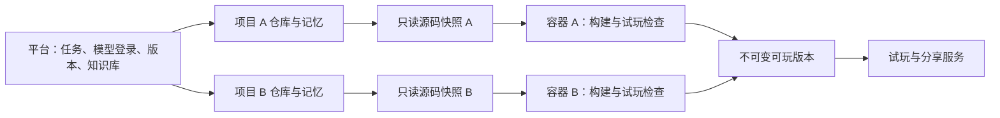

# OpenGame 创作工作台

第一条真实创作流程已经接通：描述游戏 → Codex 制作 → 项目独立容器构建与浏览器检查 → 试玩 → 对话修改 → 保存与恢复版本 → 发布分享。工作台采用试玩优先布局，不要求用户选择模型或游戏类型。

支持本机个人创作，以及少量受邀成员创作 Phaser 2D 浏览器游戏。源码按项目独立保存，生成不是替换预设游戏模板。受邀模式已加入个人访问码、项目归属、制作额度和受保护的分享链接；公网接入还需要配置实际后台主机和两个 HTTPS 地址，见[内测部署说明](deploy/README.md)。3D、联机、开放注册、跨平台发布和数字货币购买属于后续阶段。

## 启动

在仓库根目录执行：

```sh
npm install --workspace=@opengame/web --ignore-scripts
npm run runtime:prepare --workspace=@opengame/web
npm run studio
```

打开 <http://127.0.0.1:4190>。启动程序会准备本项目自己的数据库、参考作品、制作进程和游戏预览服务。已有项目会继续保留。“星尘远航”明确标为参考作品；从输入框创建的游戏使用真实 Codex 任务。

需要 Node.js 20.9+、Git、已登录的 Codex CLI、PostgreSQL 的 `initdb`/`pg_ctl`、运行中的 Docker，以及 Chrome 或 Playwright 的 Chromium（首次准备内置参考作品使用）。先启动 Docker，再执行一次 `runtime:prepare`，下载官方 Playwright 镜像并构建固定工具链；修改构建工具或检查代码后需重新执行。生成游戏的构建与自动试玩在容器内执行。使用现有数据库时设置 `OPENGAME_DATABASE_URL`，并自行管理数据库的启动。

Codex 使用运行服务的系统账号已有的 CLI 登录；可先用 `codex login status` 检查。平台没有新增 API Key 设置或模型选择入口。非交互执行和 JSON 事件依据 [Codex 官方文档](https://learn.chatgpt.com/docs/non-interactive-mode)。目标主机须使用支持命名权限配置的 CLI，并通过 `generator:check`；当前本机验证版本为 `0.162.0-alpha.17.2`。

按 Ctrl+C 停止工作台和制作进程。需要一起停止本项目数据库时，再执行：

```sh
npm run db:stop --workspace=@opengame/web
```

## 已实现的行为

| 功能       | 实际行为                                                                                   |
| ---------- | ------------------------------------------------------------------------------------------ |
| 创建和修改 | PostgreSQL 保存需求与阶段；一个 worker 串行制作，同项目禁止重叠改动；刷新页面不终止任务    |
| 失败和取消 | 显示实际失败，保留上一可玩版本；取消终止当前生成进程组；默认整次任务最多 10 分钟           |
| 检查与修复 | 平台用固定构建配置打包，浏览器点击开始、发送输入、重新开始并检查异常；失败最多修复一次     |
| 版本       | 每项目一个独立 Git 裸仓库，每个任务有独立工作目录；通过检查才切换最新可玩版本              |
| 记忆       | `design.md`、`memory.md`、游戏配置和模块记录与源码一起提交；后续任务从选定基础版本继续     |
| 恢复       | 将历史源码和游戏产物作为新的当前版本，保留全部历史；不会更改已发布版本                     |
| 发布       | 单独维护发布版本，试玩页固定使用该版本；本机模式限本机，受邀模式要求玩家先登录             |
| 受邀访问   | 每人独立访问码，只能查看和修改自己的项目；默认 10 个项目、每天 10 次、累计 100 次制作      |
| 公共能力   | 提供可选的波次调度模块，允许原创实现；锁定公共规范 0.1.0，并记录任务验证证据               |
| 独立环境   | 每项目每次检查启动专属 Docker 容器，导出通过检查的产物后回收；凭据、Git 和数据库留在平台侧 |

浏览器检查是基本可运行性检查，不等于完整游戏质量评测，也不证明已经适配触屏。当前规则经验只记录为观察，不会自动改写稳定规范。支付、真实订单或钱包连接尚未接入。

## 对话与制作过程

工作台默认展示游戏试玩和聊天，另有“制作过程”视图，自动展示每轮目标、已明确的约定、实施任务、试玩要点、实际执行阶段与可玩版本。任务由 AI 在开始实施前整理，用户不用建立节点或连线。旧版本仍可查看，缺少历史计划的版本只显示原有结果，不补造任务记录。

聊天先经过独立的只读规划环境：问题和探索只回复；尚待确定的想法可整理为方案；明确要求实施时，先原子保存结构化计划和回复，再交给制作器。也可点击方案上的“开始制作”，该操作使用当时的计划与素材快照；有新的讨论或基础版本变化时，旧方案不能启动。取消和过期执行权同样阻止规划转为制作。讨论不创建游戏版本，也不进入公共游戏经验库。

讨论与制作分别限额：制作保留原账号上限；纯对话默认每天 50 次、累计 500 次（账号制作上限的 5 倍，分别最多 100 / 10,000 次）。对话转为实施时再次检查制作额度；不足时保存方案并明确告知尚未执行，不能通过聊天绕过限制。所有请求共用串行工作队列，每个账号同一时间只处理一轮。

进度来自真实的制作、检查和保存阶段。任务列表是本轮实施范围，不显示未经证明的逐项完成率。自动检查覆盖构建、启动、输入与重开；方案中的玩法验收要点仍需试玩确认。计划随版本和 Git 保存，历史恢复保留对应计划。

## 参考资料与图片

在聊天中点击“添加参考图”可上传 PNG/JPEG，并自动加入本轮引用。上传本身不启动制作。首页的“打开创作空间，添加参考图”新建空白项目，计入项目数量但不消耗模型调用。

原有设计画布保留在辅助“项目资料”入口，可整理说明和复用素材。提交时选中内容及其间接引用会一起提供给规划与制作器；参考图通过 Codex 图片附件传入，也作为可导入的本地 PNG 素材保存。不新增模型选择或付费图片生成接口。

- 画布草稿手动保存，提交制作前自动保存。浏览器会按账号和项目保留未提交草稿；不同标签页修改不同字段时合并，同一字段冲突时要求选择，避免静默覆盖。
- 每次任务固定画布快照，后续草稿修改不影响已排队任务。通过检查的版本保存相同快照、PNG 与 Git 提交。恢复历史游戏时同步恢复当时的画布；早期没有画布的版本恢复为空画布，素材库和发布版本保留。
- 画布与图片仅项目所有者可读取；图片经过解码、方向归一和去除元数据后转为 PNG，存入私有数据库，已有数据库备份包含这些内容。素材引用只允许来自同一项目。分享的游戏可以展示其使用的素材，不包含整个设计画布。
- 首版限 24 个节点、24 张图片、单图 2 MB/400 万像素、项目素材总量 8 MB；单次选择最多 8 个节点及 4 张不同图片。移出画布不物理删除素材，以保证历史版本仍可复现。
- 三方合并算法参考 OhMyGame，保留 [Apache 2.0 许可证和修改声明](third_party/ohmygame/NOTICE.md)。当前为上传素材和设计引用，尚不包含 AI 生图、素材加工、3D 编辑或自动重写画布。

集成测试覆盖两账号和跨项目隔离、图片归一化、过期保存拒绝、任务快照冻结、历史恢复、素材校验和引用数量限制。

## 项目独立运行环境

项目身份与持久数据独立，容器按任务创建，不要求一个容器永久常驻。项目 Git、记忆和已发布版本不会随容器删除。共用的只是只读工具链镜像，各容器有自己的进程、内部端口、临时文件与资源配额。



- 每个容器为非 root 用户，根文件系统只读，移除 Linux capabilities，禁止增加权限；限制 1 CPU、1 GiB 内存和 256 个进程/线程。
- 仅挂载当前任务的只读源码快照与只读存活凭据。排除 Git 和共享上下文目录；容器中没有个人模型凭据、平台数据库连接或 Docker socket。知识库快照仍随游戏源码保存。
- 容器关闭外部网络，不映射宿主机端口。自动试玩的浏览器与临时服务在同一容器里通过内部回环地址通信。不同项目可以使用相同内部端口。
- 临时目录与产物目录各有 128 MiB 内存文件系统；平台只导出白名单中的固定文件，并检查普通文件类型与总大小。
- 成功、失败和取消都回收容器。worker 停止更新存活凭据后约 30 秒自动退出，另有 10 分钟硬上限；worker 重启时只清理本平台实例的残留容器。异常退出可能留下只读输入快照，后续可清理。
- Docker 或镜像不可用时，页面提示独立环境未就绪；制作流程在调用模型前检查并停止，不会静默改回宿主机验收。已保存和已发布游戏可继续玩。
- 新版本的验证记录包含项目编号和实际镜像摘要；界面区分容器检查的新版本和原来的本机检查版本，不追溯改写历史记录。

Codex 控制进程在主机运行，其执行的项目命令使用显式权限配置：允许当前工作目录，拒绝相邻项目和共享临时目录，禁止命令联网，忽略个人配置与项目指令扩展。平台启动时进行实际文件隔离检查，失败则停止制作服务。模型调用需要的连接与登录由控制进程使用，不传给游戏构建容器。

任务队列仍是单 worker 串行；当前不允许项目自行安装依赖，也没有常驻的游戏后端。运行镜像用于统一工具链，不限制玩法类型；不同引擎可接入各自的运行适配器。发布的浏览器游戏是静态产物，无需一直占用开发容器；联机后端需要单独的发布环境和持久化服务。受邀内测应使用专用服务账号和主机；模型执行尚未具备每任务的内存与磁盘硬配额，因此本阶段不开放匿名创作。

## 知识积累

顶部“知识库”提供本地游戏提炼的基础经验，并可预览一条新需求会参考哪些内容。首批包含《虾了吗》的纯规则、完整撤销、窄屏试玩经验和现有塔防的波次模块。

后续制作会自动选取相关经验，保存 `knowledge.lock.json` 快照；生成器用 `learning.json` 归纳本轮通用做法。游戏通过检查并保存版本后，这些做法作为带来源和验证范围的项目经验，供后续游戏参考。受邀模式默认只检索本人经验和已审核的公共经验；共享基础知识继续可用。失败或取消任务不会贡献成功经验，稳定规范不会被自动覆盖。具体机制和边界见[知识库说明](resources/knowledge/README.md)。

## 代码与数据

先在一个工作区内组织清晰的模块，不提前拆分多个空包：

- `src/components`：创作工作台与独立试玩页。
- `src/server/api.ts`、`store.ts`：请求边界、幂等任务、版本和发布状态。
- `src/server/access.ts`：邀请成员、登录会话和游戏访问凭据。
- `src/server/generator-policy.ts`、`generator-check.ts`：生成执行权限与启动检查。
- `src/server/worker-main.ts`、`codex.ts`：任务执行、取消、验收、保存恢复。
- `src/server/workspace.ts`、`build-game.ts`：项目 Git、上下文、固定构建和浏览器检查。
- `src/server/project-runtime.ts`、`runtime`：项目容器、工具链镜像、资源限制和异常回收。
- `src/server/preview-main.ts`：独立端口的只读游戏产物服务。
- `resources/modules`、`resources/standards`：可选公共模块与有版本的规范。

运行数据位于仓库根目录 `.opengame/`，已排除在 Git 外。包含数据库、各游戏私有 Git、任务工作目录和游戏产物；这些不是本平台的源码文件。项目不会自动创建 GitHub 仓库。

生成器使用显式限定读写范围的项目沙箱；构建与自动试玩进入项目独立容器，不执行游戏自行提供的 npm 脚本，只允许 Phaser 和项目内导入。用户试玩页面使用独立来源和限制能力的 iframe，禁止游戏运行时网络。平台接口检查配置的地址、写请求来源和受邀身份；每个游戏资源请求都核验可撤销的访问凭据。

worker 保存候选产物及 Git 提交后记录检查点。重启时，有检查点的任务会重新核验产物并完成保存；没有检查点的中断任务标记失败，可重新提交。中断可能留下未引用的本地工作目录，首版不自动清理。

## 配置

环境变量通过启动进程传入，不从网页接受：

| 变量                      | 默认与用途                                   |
| ------------------------- | -------------------------------------------- |
| `OPENGAME_PORT`           | `4190`，工作台监听端口                       |
| `OPENGAME_PREVIEW_PORT`   | `4191`，游戏只读预览端口                     |
| `OPENGAME_DB_PORT`        | `55432`，本项目 PostgreSQL 端口              |
| `OPENGAME_DATABASE_URL`   | 可选，自行管理的 PostgreSQL 连接             |
| `OPENGAME_DATA_DIR`       | 仓库 `.opengame/`，应使用绝对路径            |
| `OPENGAME_WEB_ROOT`       | 本包绝对路径，非标准启动目录时设置           |
| `OPENGAME_CODEX_BIN`      | `codex`，可指定本机 CLI 绝对路径             |
| `OPENGAME_CHROME_PATH`    | 可选，Chrome 可执行文件绝对路径              |
| `OPENGAME_JOB_TIMEOUT_MS` | `600000`，整个制作任务时限，含一次可能的修复 |
| `OPENGAME_ACCESS_MODE`    | `local`；正式启动必须设为 `invite`           |
| `OPENGAME_APP_ORIGIN`     | 本机 4190 地址；公网必须是 HTTPS             |
| `OPENGAME_PREVIEW_ORIGIN` | 本机 4191 地址；必须与工作台使用不同来源     |
| `OPENGAME_PREVIEW_SECRET` | 受邀模式必填，至少 32 字符的随机签名密钥     |

工作台与预览均只监听 `127.0.0.1`。正式启动使用 `build:production` 和 `start`，通过反向代理接入 HTTPS。正式构建位于 `.next-production`，与本机开发服务的 `.next` 分开，详见[内测部署说明](deploy/README.md)。

## 验证

```sh
npm run studio:check
npm run db:start --workspace=@opengame/web
npm run test:integration --workspace=@opengame/web
npm run test:runtime --workspace=@opengame/web
npm run build --workspace=@opengame/web
node scripts/check-lockfile.js
```

基础测试覆盖模块生命周期、来源限制、构建导入边界和公网配置；集成测试新建并清理独立临时数据库，覆盖请求去重、过期执行权、取消、失败保留、发布版本稳定、历史恢复、保存检查点，以及两账号间的读取与修改隔离、分享凭据失效、制作额度和登录限流。集成测试数据库账户需有创建数据库权限。

`test:runtime` 需要已准备好的 Docker 镜像。它同时启动两个测试项目，验证文件、内部端口和临时目录隔离、独立构建、停止单个容器不影响另一项目、产物与记忆保留、卡死游戏取消，以及模拟拥有者进程崩溃后的自动回收。只清理测试创建的容器和临时目录。

复验一个已有游戏：`npm run runtime:check --workspace=@opengame/web -- <项目编号>`。此命令从最新保存版本创建临时源码副本，在容器中检查，报告与产物写入 `.opengame/runtime-checks/`；不会调用模型、创建新版本或改变发布状态。《虾了吗》版本 2 已通过这条路径，原产物哈希保持一致。

实际浏览器验收使用真实 Codex 生成“星光花园”，检查新建、试玩、对话修改、记忆查看和版本发布恢复。更完整的产品与后续支付设计见 [实施规格](../../docs/developers/ai-platform-mvp-spec.md)。

本地《虾了吗》的规则生成与独立玩法对照见 [平台能力验证](benchmarks/xialema/README.md)，包含提交需求、可重复运行的规则检查器和实际结果。该检查器不会自动接入所有制作任务。
